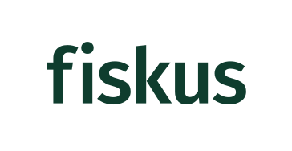

  

**Income tax, worked out in the open.**

fiskus is an independent reference engine for German income tax (Einkommensteuer), tax year 2026. It shows each step of the calculation and the code that performs it.

> Not official software of the Federal Ministry of Finance (Bundesministerium der Finanzen, BMF) or ELSTER. Not tax advice.

## Coverage

| Area | Status |
|---|---|
| Tax year | 2026 only |
| Implemented | The basic allowance (Grundfreibetrag) zone of § 32a EStG, for single and joint filing |
| Not yet in fiskus | Income types, allowances and special expenses, child allowances, tariff zones above the basic allowance, solidarity surcharge (Solidaritätszuschlag), church tax (Kirchensteuer) |
| Test coverage | At least 90% of lines, enforced by `make test-coverage` |

## Read

| Page | Read it for |
|---|---|
| [Guide](guide/README.md) | How the tax is worked out, one step at a time |
| [Using fiskus](usage/README.md) | Calling the crate from Rust |
| [Formulas](formulas/grundfreibetrag.md) | The formulas and boundaries, with citations |
| [Internal](internal/build/README.md) | How fiskus is built, tested and measured: [Build](internal/build/README.md), [Testing](internal/testing/README.md), [Benchmarks](internal/benchmarks.md) |
| [Contributing](contributing/index.md) | Workflow, code rules, tests, language, guide, design |

## License

AGPL-3.0-only. Commercial license on request: contact@kondominium.app
